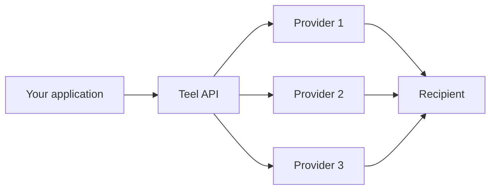
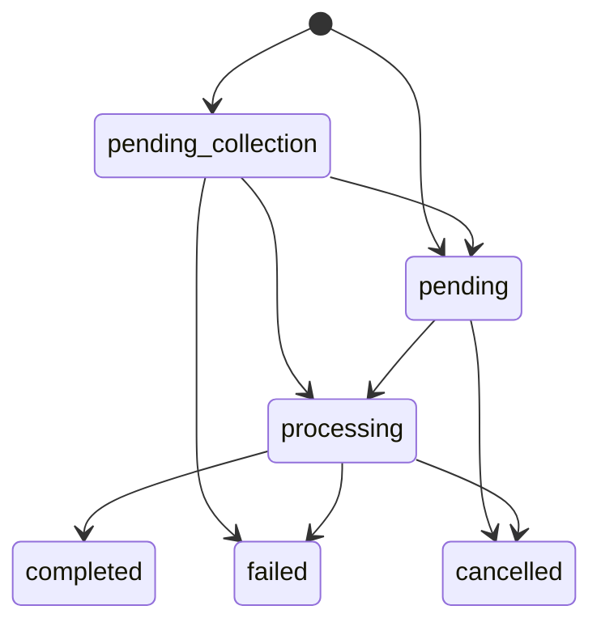
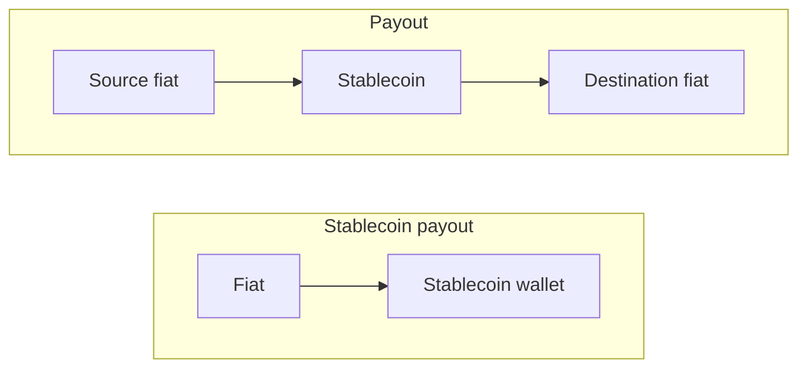
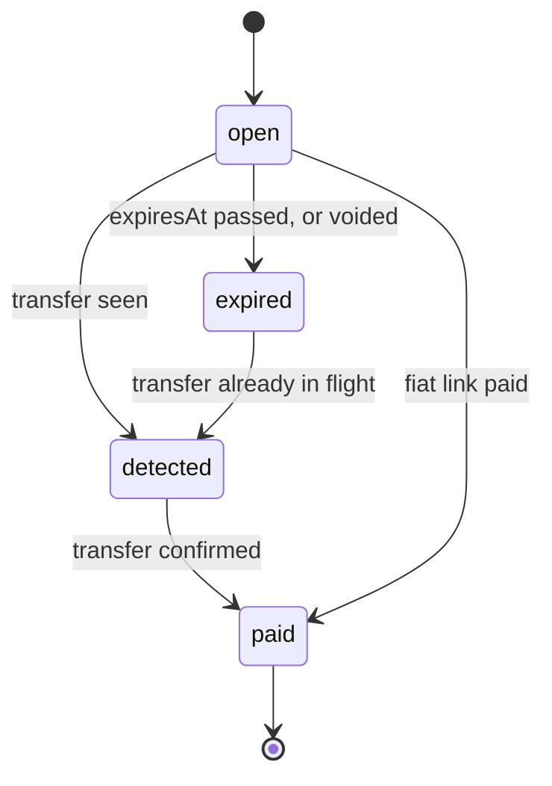
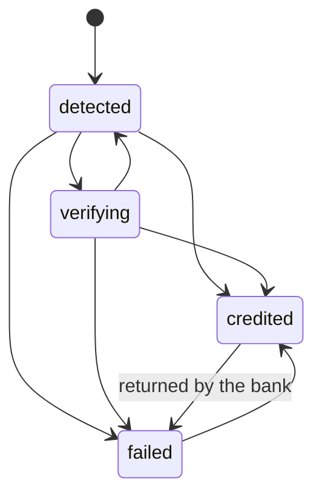
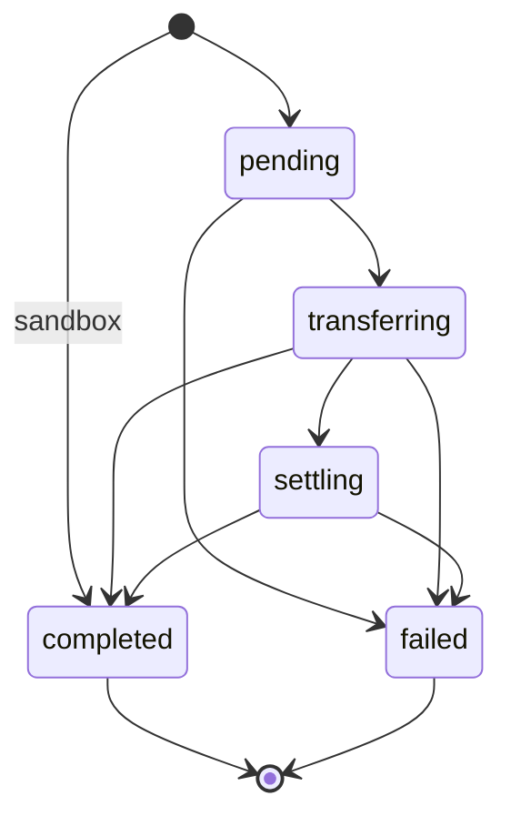

You integrate with Teel once. Behind the API, every payout fans out across a network of providers, lands on the cheapest available route, and reports back over the same status stream — regardless of which provider settled it.

## Multi-provider routing

- **No vendor lock-in** — routes are chosen per-transaction based on rate and corridor coverage.
- **Broader coverage** — the union of every provider's corridors is what your account can reach.
- **Automatic failover** — when one provider degrades, quotes still come back from the rest.

## Lifecycle of a payout

1. **KYB once** — complete business verification in the dashboard before you get API access. Teel propagates it to every provider that licenses your corridors.
2. **Add recipients** — created via the API, provisioned across providers in the background.
3. **Quote** — one request fans out to every provider on the corridor; the best route comes back.
4. **Execute** — Teel pins the chosen route with an opaque token and settles through the winning provider.

## Transaction status

| Status | Meaning |
|---|---|
| `pending` | Created, awaiting provider hand-off. No funds in motion yet. |
| `pending_collection` | A payout in a batch, waiting for the batch's shared collection. Moves on once the collection completes. |
| `processing` | Submitted to the winning provider. A Payout may involve both a collection and a disbursement leg. |
| `completed` | Recipient received the funds. Terminal. |
| `failed` | Compliance, balance, or provider error. Inspect `failureCode` on the payout. Terminal. |
| `cancelled` | Quote expired or cancelled before execution. Terminal. |

## How payouts settle

A **Payout** is settled as a collection leg (fiat in) plus a disbursement leg (fiat out), with an on-chain stablecoin hop in between. A **Stablecoin payout** uses the collection leg only — the recipient keeps the stablecoin. The legs can be served by different providers, and Teel picks each independently.

## Real-time updates

Register an HTTP webhook to be told when a payout moves, instead of polling. Callbacks are HMAC-signed; verify the signature before processing. See the [Webhooks guide](/guides/webhooks). To check one payout on demand, read [`GET /payouts/{id}`](/api-reference/payouts/get).

## Collections

Collections is the receiving side: your payers pay you, and you settle what you hold.

- **Payment links** are invoices. A `stablecoin` link is paid on-chain to the buyer's own receiving address. A `fiat` link is paid by bank transfer into your receiving account. See [Stablecoin collections](/guides/stablecoin-collections).
- **Receiving accounts** are fiat bank accounts for your business. Money paid into them arrives as **deposits**. See [Fiat collections](/guides/fiat-collections).
- **Settlements** convert what you hold and pay it out to a recipient, in fiat or USDC. See [Settlements](/guides/settlements).

All three report status changes through [webhooks](/guides/webhooks#collections-events).

## Payment link status

| Status | Meaning |
|---|---|
| `open` | Accepting payment. |
| `detected` | A stablecoin transfer was seen and is being confirmed. Not settled yet. |
| `paid` | Paid in full. Terminal. Fires `collections.payment_link.paid`. A fiat link turns `paid` once the deposits matched to it cover its amount. |
| `expired` | Past `expiresAt`, or voided. An `open` link reads as `expired` as soon as its clock runs out. A transfer already in flight at that moment is still matched for 60 minutes. |

## Deposit status

| Status | Meaning |
|---|---|
| `detected` | The bank reported an incoming payment. |
| `verifying` | The payment is being checked before it is credited. |
| `credited` | Credited to your business. Fires `collections.deposit.received`. |
| `failed` | Rejected, or returned after it was credited. |

A deposit can first appear at any of these statuses, depending on what the bank reports first. Once `credited` or `failed`, it never moves back to `detected` or `verifying`.

## Settlement status

| Status | Meaning |
|---|---|
| `pending` | Recorded. Nothing has moved yet. |
| `transferring` | The stablecoin is being sent for conversion. `transferTxHash` appears once it is sent. |
| `settling` | Sent for conversion and on its way to the recipient. |
| `completed` | Delivered. Terminal. |
| `failed` | Did not complete. `failureCode` says why. Terminal. |

Every change fires `collections.offramp.status.updated`; a settlement created as `pending` fires nothing until its first change. A settlement can go from `transferring` straight to `completed`. In sandbox, a settlement is recorded as `completed` from the start and fires one event.

### Settlement reasons

`reason` on a preview, `details.reason` on a refused settlement, and `failureCode` on a failed one all use this stable list. New values may be added, so handle unknown ones.

| Reason | Meaning |
|---|---|
| `INSUFFICIENT_BALANCE` | Not enough balance to settle. |
| `AMOUNT_EXCEEDS_BALANCE` | The amount plus fees is more than your balance. Send less. |
| `AMOUNT_BELOW_MIN` | Below the route's minimum. Settle a larger amount. |
| `AMOUNT_VARIANCE_EXCEEDED` | The amount moved by more than the allowed variance while settling. |
| `INVOICE_DOCUMENT_REQUIRED` | An invoice is required for the money being settled and none is on file. |
| `DESTINATION_INVALID` | The recipient's payment method or payout address can't receive this settlement. |
| `ROUTE_UNAVAILABLE` | No route serves this currency or destination. |
| `RATE_UNAVAILABLE` | No rate is available right now. Try again later. |
| `FEE_UNVERIFIED` | The fee could not be verified, often because a flat fee is larger than the amount. Settle a larger amount. |
| `SETTLEMENT_UNAVAILABLE` | An operational cause. Try again later, or contact support. |
| `SETTLEMENT_FAILED` | An operational failure. Contact support. |
| `SCREENING_DECLINED` | Compliance screening declined the settlement, and will decline it again. |
| `SCREENING_UNDER_REVIEW` | The settlement is held for compliance review. Settle again after 24 hours. |
