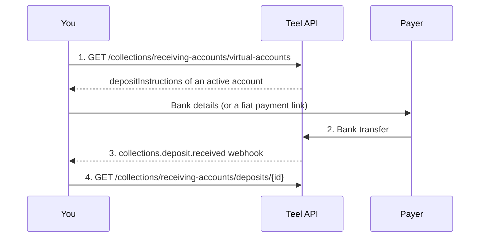

Your business holds fiat **receiving accounts** (virtual accounts). A payer sends a bank transfer to one, it arrives as a **deposit**, and Teel sends `collections.deposit.received` when the deposit is credited.

## Flow overview



<Note>
  The examples use `$TEEL_API` for the API host: `https://api.teel.finance` with an `sk_live_` key. In sandbox (`sk_test_` keys) the API is served at `https://api.teel.finance/sandbox`.
</Note>

## Before you start

Your business needs fiat collections enabled and at least one receiving account. Teel opens receiving accounts for the currencies your business selected during onboarding, and you can ask for another with **Request account** on the dashboard's Home page. Requests are normally approved automatically. The API reads receiving accounts; it can't open them.

**Who can pay in.** Payers can pay from any US state. There is no restriction on where the payer is.

**Who can hold an account.** Eligibility depends on where **your business** is based:

- US businesses based in **New York** or **Alaska** can't open USD receiving accounts.
- US businesses based in **Texas** can open USD accounts on some rails only. On the other rails, the bank accepts only transfers from the business's own accounts, so those accounts aren't offered for collecting from customers.
- A US business must have its **state on file** in its business address. Without it, Teel can't check eligibility and won't open a USD account. Complete the address in the dashboard.

You also need an API key with `collections:read`, and `webhooks:write` to subscribe. A key created from **Settings** → **API Keys** holds both.

## Step 1: Get payment details

```bash
curl $TEEL_API/collections/receiving-accounts/virtual-accounts \
  -H "Authorization: Bearer $TEEL_API_KEY"
```

Pick an account with `status: "active"` in the right `currency`, and give your payer its `depositInstructions`. If `depositInstructions.reference` is present, the payer **must** quote it on the transfer.

```json
{
  "id": "c2d4e6f8-1a3b-4c5d-8e9f-0a1b2c3d4e5f",
  "currency": "USD",
  "status": "active",
  "rails": ["ach", "wire"],
  "settlementMode": "hold",
  "depositInstructions": {
    "accountName": "Northwind Trading LLC",
    "accountNumber": "900123456789",
    "routingCode": "026073150",
    "bankName": "Example Bank, N.A."
  },
  "createdAt": "2026-09-30T04:12:00Z"
}
```

`settlementMode` decides what happens to the money:

| Mode | What happens on arrival | Where you see it |
| --- | --- | --- |
| `hold` | Stays as fiat in the account. | `fiatBalances` on [Get balances](/api-reference/collections/balances). |
| `auto_onramp` | Converted to `asset` on `chain` (for example USDC on Polygon). | `held` on Get balances; the deposit carries `creditedAmount` and `creditedAsset`. |

### Or invoice with a payment link

You can also [create a payment link](/api-reference/collections/payment-links/create) with `collectionType: "fiat"`. The payer page at its `url` shows your receiving account's bank details and, where the bank rail carries one, the reference to quote.

<Note>
  A credited deposit is matched to its fiat link (by the reference the payer quoted, or by an exact amount when only one open link is for that amount). Deposits that cover part of a link add up, and the link turns `paid` once they cover its amount, firing `collections.payment_link.paid`. A deposit that can't be matched is matched by hand in the Teel dashboard.
</Note>

## Step 2: Subscribe to the webhook

```bash
curl -X POST $TEEL_API/webhooks/subscriptions \
  -H "Authorization: Bearer $TEEL_API_KEY" \
  -H "Content-Type: application/json" \
  -d '{
    "url": "https://your.app/teel-webhook",
    "events": ["collections.deposit.received"]
  }'
```

The event needs `collections:read` on the subscribing key.

## Step 3: Receive the deposit

A deposit moves through `detected` and `verifying` to `credited` (see [Deposit status](/concepts#deposit-status)). On `credited`, Teel sends `collections.deposit.received`:

```json
{
  "type": "collections.deposit.received",
  "createdAt": "2026-10-13T14:20:46Z",
  "data": {
    "id": "e1f2a3b4-c5d6-4e7f-8a9b-0c1d2e3f4a5b",
    "virtualAccountId": "c2d4e6f8-1a3b-4c5d-8e9f-0a1b2c3d4e5f",
    "amount": "5000.00",
    "currency": "USD",
    "status": "credited",
    "senderName": "ACME IMPORTS LTD",
    "senderReference": "20261013MMQFMP2K000123",
    "createdAt": "2026-10-13T14:02:11Z",
    "updatedAt": "2026-10-13T14:20:45Z"
  }
}
```

The event fires once per deposit, when it becomes `credited`. A credited deposit the bank later returns moves to `failed`; re-read it with [Get deposit](/api-reference/collections/deposits/get) if you need its current status.

To reconcile without webhooks, page through [List deposits](/api-reference/collections/deposits/list), optionally filtered by `virtualAccountId`.

## Testing in sandbox

In sandbox, simulate a payment through a fiat payment link. The simulator marks the link `paid`:

1. Create a `fiat` payment link in a currency your sandbox business holds a receiving account for. Otherwise creation returns `422`.
2. Call the public simulator with the link's `reference`:

```bash
curl -X POST $TEEL_API/sandbox/collections/payment-links/PL-MZ7Q4WX2NB5KD3RTY6PLVHC2EA/test-fiat-payment
```

The link turns `paid` and you receive `collections.payment_link.paid`. Calling it again on a paid link is safe. The simulator is limited to 1 request per second per IP. It refuses `stablecoin` links (`422 SANDBOX_RULE_VIOLATION`) and links that are expired or voided (`409 CONFLICT`). See [Simulate payment in sandbox](/guides/stablecoin-collections#simulate-payment-in-sandbox).

## Next steps

Settle your stablecoin balance (`held`), including what `auto_onramp` accounts converted, to a recipient. See [Settlements](/guides/settlements).
