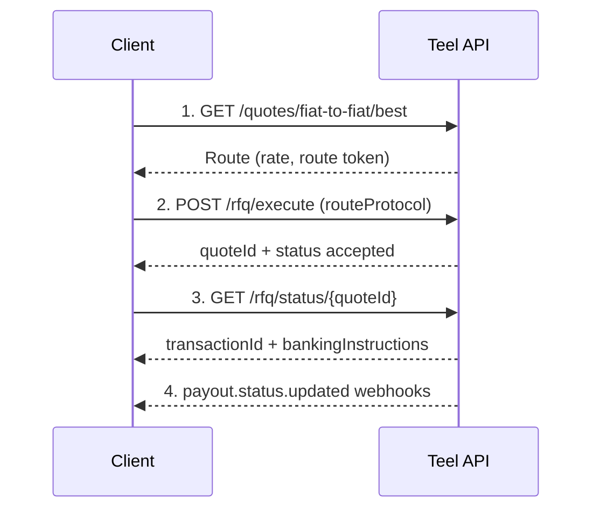

This guide walks through sending a cross-border fiat payment from one currency to another, for example USD → MYR. The flow is: quote, execute, fund, track.

## Flow overview



## Prerequisites

- An API key (`sk_live_…` / `sk_test_…`) for an account whose KYB covers the corridor.
- A [funding payment method](/guides/payment-methods) set up in the dashboard. You send its id as `userPaymentMethodId`.
- A [recipient](/guides/recipients) with a bank payment method in the destination currency. Save its `recipientId`.

## Step 1: Get a quote

Fetch the best route for your currency pair. Pass `recipientId` so the quote prices delivery to the recipient's bank:

```bash
curl "https://api.teel.finance/api/quotes/fiat-to-fiat/best?sourceCurrency=USD&targetCurrency=MYR&amount=1000&recipientId=8f3c2a91-4e5b-4d8c-9a1f-3e2b1c4d5e6f" \
  -H "Authorization: Bearer $TEEL_API_KEY"
```

```json
{
  "success": true,
  "data": {
    "protocol": "rt_9f8a…",
    "fromCcy": "USD",
    "toCcy": "MYR",
    "fromAmount": "1000",
    "toAmount": "4425.00",
    "effRate": 4.425,
    "fee": "5.00",
    "bridgingAsset": "USDCPOLYGON",
    "validUntil": "2026-03-10T10:05:00Z"
  }
}
```

Keep the `protocol` route token and `bridgingAsset` to pin this route at execution. Execute before `validUntil`. When no route is available, `data` is `null` and `noRouteReason` says why. See [Get best fiat-to-fiat quote](/api-reference/quotes/fiat-to-fiat-best).

## Step 2: Execute the payout

Send the corridor and amount, your funding source, and the route token. If the route's `offrampRequirements` asks for a supporting document, upload it first and send its `supportingDocumentFileId`; see [Supporting documents](/guides/supporting-documents).

```bash
curl -X POST https://api.teel.finance/api/rfq/execute \
  -H "Authorization: Bearer $TEEL_API_KEY" \
  -H "Content-Type: application/json" \
  -H "Idempotency-Key: $(uuidgen)" \
  -d '{
    "fromCurrency": "USD",
    "toCurrency": "MYR",
    "amount": 1000,
    "recipientId": "8f3c2a91-4e5b-4d8c-9a1f-3e2b1c4d5e6f",
    "userPaymentMethodId": "e5f6a7b8-c9d0-4e1f-8a2b-3c4d5e6f7a8b",
    "routeProtocol": "rt_9f8a…",
    "bridgingAsset": "USDCPOLYGON",
    "paymentPurpose": "goods_or_services"
  }'
```

The response carries the `quoteId` and `status: "accepted"`. The payout is created just after the call answers, so `payoutId` is empty. Always check `success`: a quote that cannot be locked answers `success: false` with an `error.code`.

## Step 3: Get the payout id and fund it

Poll the quote's status until `transactionId` appears:

```bash
curl https://api.teel.finance/api/rfq/status/{quoteId} \
  -H "Authorization: Bearer $TEEL_API_KEY"
```

`transactionId` is the payout id for [`GET /payouts/{id}`](/api-reference/payouts/get). When the route collects by bank transfer, `bankingInstructions` holds the account to pay the source amount into; the payout's `providerMetadata.onramp` carries the same details.

## Step 4: Track the payout

A payout moves through `status` `pending` → `processing` → `completed` (or `failed`). Within it, `step` reports progress: `initiated → compliance_cleared → instructions_sent → collected → converting → settling → delivered`. A delivered payout is `completed` with `step` `delivered`.

Subscribe to `payout.status.updated` rather than polling. See the [Webhooks guide](/guides/webhooks).
