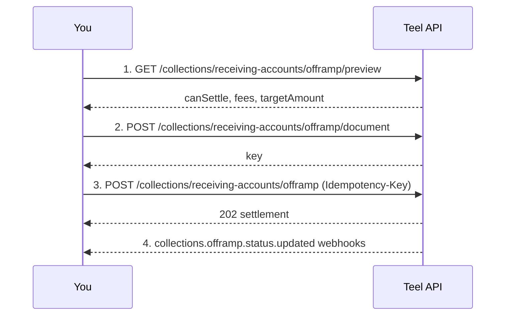

A **settlement** converts stablecoin you hold and pays it to a recipient, in fiat or as USDC. The flow is preview → upload invoice → settle → webhook.

## Flow overview



<Note>
  The examples use `$TEEL_API` for the API host: `https://api.teel.finance` with an `sk_live_` key. In sandbox (`sk_test_` keys) the API is served at `https://api.teel.finance/sandbox`.
</Note>

## Before you start

- **Scopes.** `collections:read` to preview and read, and `settlements:write` to upload and settle. `settlements:write` is separate so that a key can manage collections without being able to move money.
- **A recipient.** Create one with the [Recipients API](/guides/recipients). You settle to one of its payment methods, using the `id` of one of the recipient's `paymentMethods`.
- **A Teel-signed wallet.** See [Custody](#custody) below.

## Which balance settles

Your stablecoin balance is held in two classes. On the settlement, `asset` picks one; `riskClass` is optional and, when sent, must match it. On the preview, pick one with `riskClass`:

| `asset` | `riskClass` | Typically holds |
| --- | --- | --- |
| `USDC` | `low` (preview default) | What `auto_onramp` receiving accounts converted. |
| `USDT` | `high` | What stablecoin payment links collected. |

[Get balances](/api-reference/collections/balances) shows both under `held`.

## Step 1: Preview

```bash
curl -G $TEEL_API/collections/receiving-accounts/offramp/preview \
  -H "Authorization: Bearer $TEEL_API_KEY" \
  --data-urlencode "amount=1000" \
  --data-urlencode "targetFiatCurrency=USD" \
  --data-urlencode "recipientPaymentMethodId=3f2e1d0c-9b8a-4c7d-8e6f-5a4b3c2d1e0f" \
  --data-urlencode "riskClass=high"
```

```json 200
{
  "canSettle": true,
  "exactness": "exact",
  "sourceAmount": "1001.210000",
  "totalDebit": "1003.210000",
  "feeAmount": "3.210000",
  "targetAmount": "1000.00",
  "targetCurrency": "USD",
  "balance": "4210.550000",
  "spendSettle": true
}
```

The preview runs the same quote and plan as the settlement, and moves nothing. If `canSettle` is `false`, `reason` says why (see [settlement reasons](/concepts#settlement-reasons)). Fix that before you settle.

`amount` is what the recipient receives by default, with fees on top (`totalDebit`). To spend an exact amount from your balance instead, send `amountIs=spend`. Use it on the settlement only when the preview returns `spendSettle: true`.

## Step 2: Upload the outgoing invoice

Every settlement needs the invoice for the payment you are making. Upload it as `multipart/form-data`. PDF, JPG, PNG or WEBP, up to 5 MB.

```bash
curl -X POST $TEEL_API/collections/receiving-accounts/offramp/document \
  -H "Authorization: Bearer $TEEL_API_KEY" \
  -F "document=@invoice-1042.pdf"
```

Keep the returned `fileId`. You send it as `outgoingInvoiceDocumentFileId` in the next step.

## Step 3: Settle

`Idempotency-Key` is **required**. Use a value that names this settlement, such as your own payout ID, so a retry can never pay twice.

```bash
curl -X POST $TEEL_API/collections/receiving-accounts/offramp \
  -H "Authorization: Bearer $TEEL_API_KEY" \
  -H "Idempotency-Key: settle-inv-1042" \
  -H "Content-Type: application/json" \
  -d '{
    "asset": "USDT",
    "amount": 1000,
    "targetFiatCurrency": "USD",
    "recipientPaymentMethodId": "3f2e1d0c-9b8a-4c7d-8e6f-5a4b3c2d1e0f",
    "riskClass": "high",
    "outgoingInvoiceDocumentFileId": "<fileId from step 2>"
  }'
```

The call answers `202` with the settlement. If it is still running after about 20 seconds, the answer comes early, with the current status (`pending` or `transferring`). Keep the `id`.

Rarely, the early answer comes before the settlement is recorded. Then the body is `{"idempotencyKey": "settle-inv-1042", "status": "pending"}` and nothing has moved. Send the same request with the same key again to get the settlement.

### Retrying safely

| You send | You get |
| --- | --- |
| The same key and the same `amount`, `targetFiatCurrency`, `riskClass`, `recipientPaymentMethodId` and `payoutAddressId` | The same settlement, in its current status, with `Idempotency-Replayed: true`. |
| The same key with a different request | `409 IDEMPOTENCY_KEY_REUSED`. |
| The same key after a settlement that failed before moving anything | A fresh attempt. |

## Step 4: Track it

Subscribe to `collections.offramp.status.updated` (needs `collections:read`). You get one event per status change, with the settlement as `data`:

```json
{
  "type": "collections.offramp.status.updated",
  "createdAt": "2026-10-14T01:12:41Z",
  "data": {
    "id": "a7b8c9d0-e1f2-4a3b-8c4d-5e6f7a8b9c0d",
    "status": "completed",
    "sourceAmount": "1001.210000",
    "sourceAsset": "USDTTRON",
    "targetAmount": "1000.00",
    "targetCurrency": "USD",
    "feeAmount": "2.000000",
    "recipientPaymentMethodId": "3f2e1d0c-9b8a-4c7d-8e6f-5a4b3c2d1e0f",
    "transferTxHash": "5d1e8f3a9c2b7e4f6a0d1c3b5e7f9a2c4d6e8f0a1b3c5d7e9f2a4c6e8b0d1f3a",
    "createdAt": "2026-10-13T15:00:02Z",
    "updatedAt": "2026-10-14T01:12:40Z"
  }
}
```

Statuses run `pending` → `transferring` → `settling` → `completed`, or end in `failed` with a `failureCode`. See [Settlement status](/concepts#settlement-status). Without a webhook, poll [Get settlement](/api-reference/collections/settlements/get).

## Custody

A settlement through the API is allowed only when Teel can sign for the wallet that holds your balance:

- a **custodial** wallet, or
- for the USDT balance (`riskClass: "high"`) only, a wallet where you have granted Teel a **scoped settle signer**. For the USDC balance (`riskClass: "low"`), a wallet your business controls is refused even with a scoped signer.

If your business controls the wallet itself, a settlement needs your own authorization, which an API key can't give. The API checks this before anything moves and returns `409 SETTLEMENT_REQUIRES_DASHBOARD_AUTHORIZATION`. Settle those balances from the Teel dashboard.

## Holds and refusals

| Situation | Response |
| --- | --- |
| Converting to fiat is not enabled for your account yet | `403 MANUAL_CONVERT_DISABLED` for any fiat target. A `USDC` payout still works, and so does preview. |
| No invoice key, or a key you did not upload | `400 OUTGOING_INVOICE_DOCUMENT_REQUIRED` or `422 OUTGOING_INVOICE_DOCUMENT_INVALID`. |
| The amount is more than your uncommitted balance, or another settlement of it is running | `409 insufficient_available_balance`. Send less, or retry shortly. |
| Teel can't carry out the settlement | `422 SETTLEMENT_REFUSED`, with `details.reason` and, when one was recorded, `details.settlement`. |
| A downstream service failed | `502` or `503 DOWNSTREAM_UNAVAILABLE`, with the same `details`. |
| Settlement is switched off | `503 OFFRAMP_DISABLED`. |

The full list is on [Create settlement](/api-reference/collections/settlements/create#errors).

## Sandbox

In sandbox, settlements are simulated. Nothing leaves the platform, the custody check does not apply, and the settlement is recorded as `completed` straight away. You receive one `collections.offramp.status.updated` with `status: "completed"`. The preview, invoice upload, idempotency and balance checks behave as they do in production.
