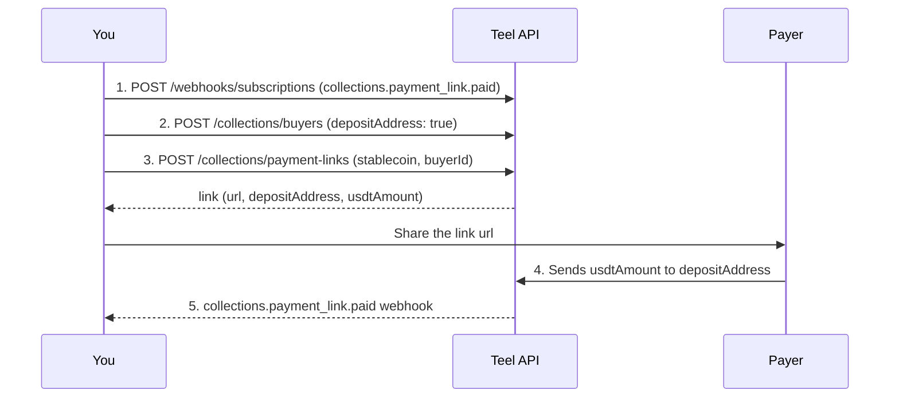

Collect payment in stablecoin: create a buyer, issue them a payment link, and receive `collections.payment_link.paid` when it is paid. In sandbox you can pay the link yourself with a real testnet transfer, so you can run the whole flow without a wallet.

## Flow overview



## Prerequisites

- An API key with `collections:read` and `collections:write`, plus `webhooks:write` to subscribe. The sandbox key minted when you sign up includes the collections scopes but not `webhooks:write`. Create the subscription from the dashboard's **Webhooks** page instead, or ask support for the scope.
- Stablecoin collections enabled on your business. Without it, link calls return `403 COLLECTIONS_NOT_ENABLED`.
- An HTTPS endpoint that [verifies webhook signatures](/guides/webhooks#verifying-signatures).

<Note>
  The examples use `$TEEL_API` for the API host: `https://api.teel.finance` with an `sk_live_` key. In sandbox (`sk_test_` keys) the API is served at `https://api.teel.finance/sandbox`.
</Note>

## Step 1: Subscribe to the webhook

```bash
curl -X POST $TEEL_API/webhooks/subscriptions \
  -H "Authorization: Bearer $TEEL_API_KEY" \
  -H "Content-Type: application/json" \
  -d '{
    "url": "https://your.app/teel-webhook",
    "events": ["collections.payment_link.paid"],
    "label": "collections"
  }'
```

Store the `secret` from the response; it is shown once. See [Create subscription](/api-reference/webhooks/subscriptions/create).

## Step 2: Create a buyer

A buyer is the payer you invoice. Set `depositAddress: true` so Teel mints the buyer's own receiving address. Every stablecoin link you issue to them is paid to that address, which is how Teel knows whose payment it is.

```bash
curl -X POST $TEEL_API/collections/buyers \
  -H "Authorization: Bearer $TEEL_API_KEY" \
  -H "Content-Type: application/json" \
  -H "Idempotency-Key: buyer-acme-imports" \
  -d '{
    "name": "Acme Imports Ltd",
    "email": "ap@acme-imports.example",
    "depositAddress": true
  }'
```

```json 201
{
  "id": "5a1f0d3e-8b2c-4e7a-9f61-2c3d4e5f6a7b",
  "name": "Acme Imports Ltd",
  "email": "ap@acme-imports.example",
  "receivingAddress": "TJ3pXbWq6kq1N9GmV2eYcR8sLhD4uZaF7w",
  "receivingChain": "tron",
  "credit": [],
  "createdAt": "2026-10-13T08:55:00Z",
  "updatedAt": "2026-10-13T08:55:00Z"
}
```

<Warning>
  Check that `receivingAddress` is present. The API has no separate call to mint it later, and a stablecoin link can't be issued to a buyer without one.
</Warning>

## Step 3: Create a payment link

```bash
curl -X POST $TEEL_API/collections/payment-links \
  -H "Authorization: Bearer $TEEL_API_KEY" \
  -H "Content-Type: application/json" \
  -H "Idempotency-Key: inv-1042" \
  -d '{
    "collectionType": "stablecoin",
    "buyerId": "5a1f0d3e-8b2c-4e7a-9f61-2c3d4e5f6a7b",
    "currency": "USD",
    "amount": "75.00",
    "invoiceNumber": "INV-1042"
  }'
```

The response carries what the payer needs:

- `url`: the payer page. Share it, or let Teel email it to the buyer.
- `depositAddress` and `chain`: where to send.
- `usdtAmount`: how much to send, in the settlement asset. The rate is locked now and holds for the life of the link.
- `reference`: the link's public reference. The sandbox simulator takes it.

If your account requires a negotiated rate, also send `usdtRate`. See [Create payment link](/api-reference/collections/payment-links/create) for every field.

## Step 4: Pay it

In production, the payer sends `usdtAmount` to `depositAddress` from their own wallet, or follows `url`.

### Simulate payment in sandbox

Sandbox has two public simulator routes. They take the link's `reference` and need no API key, because they stand in for the payer. Like every route, they answer with or without the `/api` prefix, so `$TEEL_API/sandbox/collections/…` below is `POST /api/sandbox/collections/…`.

<Tabs>
  <Tab title="Stablecoin link">
    `POST /api/sandbox/collections/payment-links/{reference}/test-payment` sends `usdtAmount` to the link's deposit address from Teel's sandbox payer. **This is a real testnet transfer on Tron Nile**, so the link goes through the same detection and confirmation as a real payment.

    ```bash
    curl -X POST $TEEL_API/sandbox/collections/payment-links/PL-K5XQ2M7RZJ4NVB6TQW3YHPDLCE/test-payment
    ```

    ```json 200
    {
      "txRef": "7c1f9e2d4b6a8c0e1f3a5b7d9c2e4f6a8b0d1c3e5f7a9b2c4d6e8f0a1b3c5d7e",
      "amount": "75.112500",
      "depositAddress": "TJ3pXbWq6kq1N9GmV2eYcR8sLhD4uZaF7w",
      "simulated": true
    }
    ```
  </Tab>
  <Tab title="Bank-transfer link">
    `POST /api/sandbox/collections/payment-links/{reference}/test-fiat-payment` marks an open `fiat` link paid, as though the payer had wired the invoice amount quoting its reference.

    ```bash
    curl -X POST $TEEL_API/sandbox/collections/payment-links/PL-MZ7Q4WX2NB5KD3RTY6PLVHC2EA/test-fiat-payment
    ```

    The response has the link's `reference`, `status`, `amount`, `currency`, a `note` describing what was booked, `simulated: true`, and sometimes a `backing` object describing the simulated balance movement. Calling it again on a paid link is safe. It refuses `stablecoin` links (`422 SANDBOX_RULE_VIOLATION`) and links that are expired or voided (`409 CONFLICT`). Outside sandbox, see [Fiat collections](/guides/fiat-collections#or-invoice-with-a-payment-link) for how to detect fiat payments.
  </Tab>
</Tabs>

**Sandbox limits**

| Limit | Value | What happens |
| --- | --- | --- |
| Payments per link | One | A second `test-payment` on the same link returns `409 CONFLICT`. |
| Test-payment total per business | 100 USDT per rolling 24 hours | Past it, `429 RATE_LIMITED`. |
| Largest link you can test-pay | 100 USDT (`usdtAmount`) | A larger link returns `422 SANDBOX_RULE_VIOLATION`. Issue a smaller invoice. |
| Request rate | 1 request per second per IP (short bursts allowed) | `429` with `Retry-After`. This body has no `code`. |

`test-payment` also refuses a link that is not `open` (`409 CONFLICT`), a link with no buyer (`422 SANDBOX_PAYER_LINK_HAS_NO_BUYER`), and a `fiat` link (`422 SANDBOX_PAYER_WRONG_SETTLEMENT_ASSET`). Both return `403 SANDBOX_PROD_REFUSED` in production.

## Step 5: Receive the webhook

A stablecoin link moves `open` → `detected` when the transfer is seen, then `detected` → `paid` once it is confirmed. On `paid`, Teel sends `collections.payment_link.paid`. Its `data` is the link, with `paidAt` and `paymentTxHashes` filled in:

```json
{
  "type": "collections.payment_link.paid",
  "createdAt": "2026-10-14T03:12:46Z",
  "data": {
    "id": "0b6f2c1e-3c1d-4f43-9a55-2a7f3d1e9c10",
    "reference": "PL-K5XQ2M7RZJ4NVB6TQW3YHPDLCE",
    "status": "paid",
    "amount": "75.00",
    "currency": "USD",
    "collectionType": "stablecoin",
    "paidAt": "2026-10-14T03:12:44Z",
    "paymentTxHashes": ["7c1f9e2d4b6a8c0e1f3a5b7d9c2e4f6a8b0d1c3e5f7a9b2c4d6e8f0a1b3c5d7e"]
  }
}
```

(Trimmed. The full payload is in the [Webhooks guide](/guides/webhooks#collections-events).)

Without a webhook, poll [Get payment link](/api-reference/collections/payment-links/get) until `status` is `paid`. Use [Get balances](/api-reference/collections/balances) to see the collected amount in `held`.

## Managing links

- **Void** an unpaid link with [Void payment link](/api-reference/collections/payment-links/void). It then reads as `expired`.
- **Expiry**: a link stops accepting new payments at `expiresAt`. A transfer already in flight is still matched for 60 minutes after.
- **List** links by `status` or `buyerId` with [List payment links](/api-reference/collections/payment-links/list).

## Next steps

Settle what you collected to a bank account or a USDC wallet. See [Settlements](/guides/settlements). Stablecoin links collect into your USDT balance, so settle them with `asset: "USDT"` (preview with `riskClass=high`).
