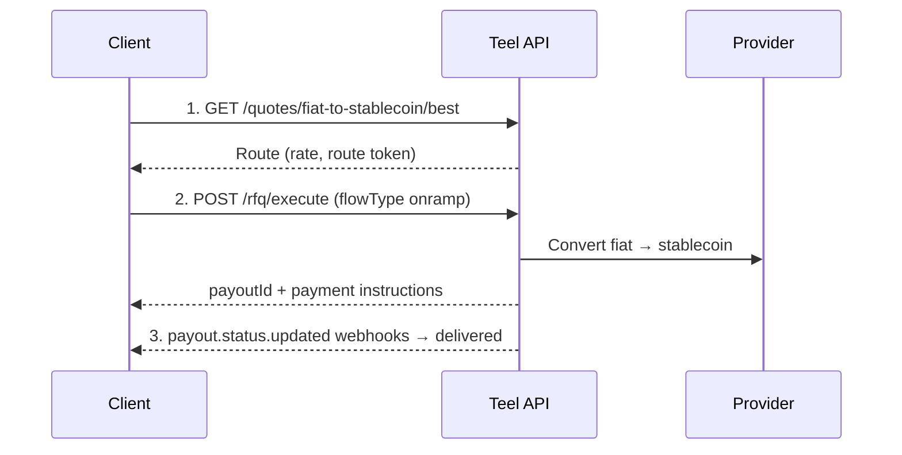

Pay a recipient in stablecoin (e.g. USDC) while funding the payout with fiat. The flow is the same quote → execute → track pattern as a fiat payout — the only difference is the recipient receives stablecoin in a wallet instead of fiat in a bank account.

## Flow overview



## Prerequisites

- An API key whose KYB covers the corridor.
- A [funding payment method](/guides/payment-methods) set up in the dashboard. You send its id as `userPaymentMethodId`.
- A [recipient](/guides/recipients) with `transferType: "stablecoin"` and a wallet payment method (token + `rail` for the chain). Save its `recipientId`.

## Step 1: Get a quote

`cryptoTicker` is the stablecoin the recipient receives:

```bash
curl "https://api.teel.finance/api/quotes/fiat-to-stablecoin/best?sourceCurrency=USD&amount=1000&cryptoTicker=USDCPOLYGON" \
  -H "Authorization: Bearer $TEEL_API_KEY"
```

```json
{
  "success": true,
  "data": {
    "stablecoinQuote": {
      "protocol": "rt_4b2c…",
      "fromCcy": "USD",
      "toCcy": "USDCPOLYGON",
      "fromAmount": "1000",
      "toAmount": "998.50",
      "effRate": 0.9985,
      "fee": "1.50",
      "validUntil": "2026-03-11T12:05:00Z"
    },
    "netToAmount": "998.50"
  }
}
```

See [Get best fiat-to-stablecoin quote](/api-reference/quotes/fiat-to-stablecoin-best) for every field.

## Step 2: Execute

Set `flowType` to `onramp`; without it the payout is treated as fiat-to-fiat.

```bash
curl -X POST https://api.teel.finance/api/rfq/execute \
  -H "Authorization: Bearer $TEEL_API_KEY" \
  -H "Content-Type: application/json" \
  -H "Idempotency-Key: $(uuidgen)" \
  -d '{
    "flowType": "onramp",
    "fromCurrency": "USD",
    "toCurrency": "USDC",
    "amount": 1000,
    "recipientId": "8f3c2a91-4e5b-4d8c-9a1f-3e2b1c4d5e6f",
    "userPaymentMethodId": "e5f6a7b8-c9d0-4e1f-8a2b-3c4d5e6f7a8b",
    "routeProtocol": "rt_4b2c…"
  }'
```

The response carries the `payoutId`, the `quoteId`, and how to pay the fiat: a `paymentUrl` or `bankingInstructions`. Once the fiat arrives, the stablecoin is delivered to the wallet on the recipient's payment method.

## Step 3: Track the payout

Read [`GET /payouts/{payoutId}`](/api-reference/payouts/get), or poll [`GET /rfq/status/{quoteId}`](/api-reference/payouts/status). For production, subscribe to `payout.status.updated` rather than polling. See the [Webhooks guide](/guides/webhooks).

<Note>
Sending a payout funded **with** stablecoin (stablecoin-to-stablecoin, including cross-chain) is configured in the dashboard, not the partner API — see [Crypto payouts](/guides/crypto-payout).
</Note>
